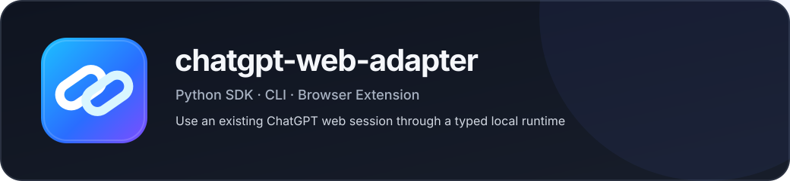
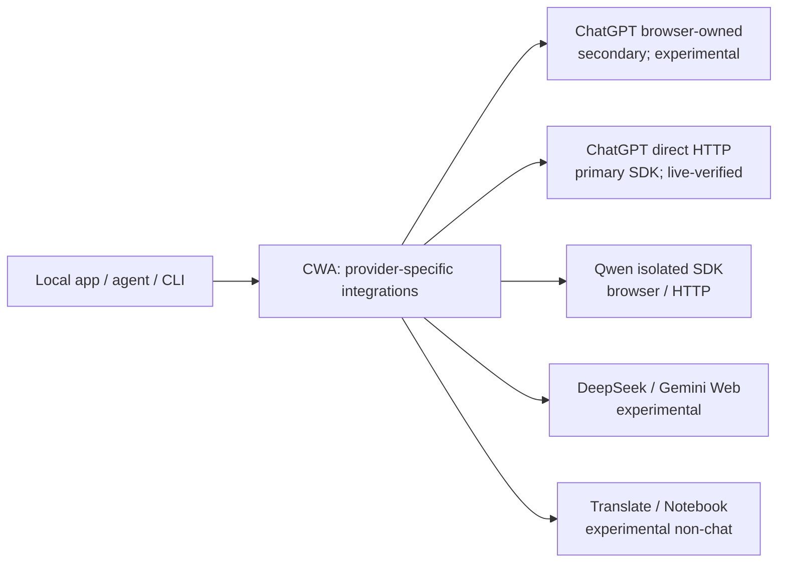

# chatgpt-web-adapter

<p align="center">
  
</p>

[](https://github.com/kymuco/chatgpt-web-adapter/actions/workflows/ci.yml)
[](https://pypi.org/project/chatgpt-web-adapter/)
[](https://pypi.org/project/chatgpt-web-adapter/)
[](LICENSE)

**Use your signed-in ChatGPT web session from Python or the terminal.** CWA is a local SDK and CLI for integrating consumer AI web products into applications and agents. Its primary ChatGPT path is authenticated Direct HTTP; other provider integrations have separate, mostly experimental contracts.

CWA is **not an official provider API** and does not treat a partial response, visible browser state or a failed send as proof of successful completion.

[Quickstart](docs/quickstart.md) · [Qwen (EN)](QWEN.md) · [Qwen (RU)](QWEN.ru.md) · [Capabilities](docs/capabilities.md) · [Agent integration](docs/agent_integration.md) · [Documentation](docs/README.md) · [Providers](docs/providers.md) · [Qwen SDK](docs/qwen.md) · [Status](STATUS.md) · [Architecture](docs/architecture.md) · [Security](SECURITY.md)

> [!WARNING]
> CWA is not an official API client for OpenAI, Google, DeepSeek or Qwen. It works with
> ordinary consumer web products and depends on product behavior that may change.

> **Product observation is not authority. Incremental output is not canonical finality.
> Ambiguous writes are never automatically retried.**

## First ChatGPT result

Python 3.10–3.14, Node.js 24+, `curl` and a signed-in ChatGPT account are required. The optional `[browser]` extra is for **initial interactive authentication**, not for Direct HTTP sending:

```powershell
python -m pip install "chatgpt-web-adapter[browser]"
chatgpt-web-adapter auth login --auth-file auth_data.json
cwa send "Explain CWA in two sentences." --profile HIGH
```

Already authenticated? The last command is enough. `cwa send` uses **Direct HTTP by default in released v0.4.1**; it needs no running Chrome tab. Python users can import `BrowserlessHTTPClient`; see [a minimal example](examples/direct_http_send.py) and the [quickstart](docs/quickstart.md). Never commit `auth_data.json`.

**Agent?** Read [AGENTS.md](AGENTS.md) for repository work, [agent integration](docs/agent_integration.md) for tool calls, and [llms.txt](llms.txt) for discovery. `cwa doctor/status/capabilities/messages` still inspect the **legacy product runtime** by default, not Direct HTTP send health. There is no automatic transport fallback or replay after an uncertain send.

## Start here

| You are... | Best first step |
| --- | --- |
| Trying ChatGPT from Python | [Direct HTTP (primary SDK)](#chatgpt-recommended-direct-http) |
| Using the secondary browser-owned UI path | [Browser-owned Python example](#production-python-example) |
| Using ChatGPT without a browser tab | [Direct HTTP SDK guide](docs/browserless_http_sdk.md) |
| Connecting a local assistant or coding agent | [Agent integration](docs/agent_integration.md) |
| Checking what is actually supported | [Live capability matrix](#capability-matrix-current-main) · [Full map](docs/capabilities.md) |
| **Only want Qwen in the terminal?** | **[Qwen quickstart (English)](QWEN.md) · [Русская инструкция](QWEN.ru.md)** |
| Using experimental Qwen Web in Python | [Complete Qwen SDK guide](docs/qwen.md) |
| Adding a new hosted product capability | [Capability contribution guide](docs/adding_capability.md) |

Current proven product surfaces include:

- **ChatGPT** — Direct HTTP as the primary live-verified ChatGPT SDK; browser-owned retained as a secondary experimental UI option and the legacy runtime default;
- **DeepSeek Web** — experimental text new-chat + continuation;
- **Gemini Web** — experimental text new-chat + continuation;
- **Qwen Web** — isolated experimental text, network streaming and conversation reattachment (user-verified on Windows);
- **Google Translate Web** — experimental non-chat `translate_text` capability;
- **Gemini Notebook Web** — experimental persistent-workspace `add_url_source` and background `generate_audio_overview` capabilities.

The Google Translate and Gemini Notebook proofs are intentionally separate from the
conversation-shaped provider contract. See [docs/capabilities.md](docs/capabilities.md).

## What CWA is

CWA connects local software to authenticated consumer AI products through
provider-specific runtime contracts. For new ChatGPT integrations, Direct HTTP
is the recommended primary SDK for validated operations. Browser-owned remains
the existing SDK default for compatibility, not an automatic fallback. Support
and finality boundaries differ; see the [runtime map](#runtime-map).

`ProductProviderBoundary` (schema 2) is **not** an execution router. It is a
provider-neutral metadata/invariant view over an already-created conversational
runtime, not a universal provider selector. The Qwen **browser** SDK uses a separate extension and Native Messaging
host; its direct HTTP mode remains experimental. The ChatGPT
`BrowserlessHTTPClient` is a separate opt-in SDK, not the historical
`browserless-request` runtime transport. Google Translate and Gemini Notebook
retain module-only non-chat contracts rather than pretending to be conversations.

The shared architecture preserves explicit:

- provider identity and product semantics;
- capability state;
- transport/support tier;
- execution provenance;
- canonical-readback requirements;
- write and retry authority;
- ambiguous-write reconciliation;
- finality claims.

Provider differences remain visible instead of being forced into a fake universal chat
API.

## ChatGPT recommended: Direct HTTP

For **new ChatGPT integrations**, start with the explicit
`BrowserlessHTTPClient` when it supports the operation you need. It uses the
authenticated ChatGPT web session over HTTP and does **not** create or control
a Chrome tab. Requires an existing `auth_data.json`, Node.js 24+ and curl.
See the [Direct HTTP SDK guide](docs/browserless_http_sdk.md) for setup,
continuation, streaming, research, images and known limits.

```python
from chatgpt_web_adapter.browserless_http import BrowserlessHTTPClient

client = BrowserlessHTTPClient(auth_file="auth_data.json")
response = client.send(
    "Summarize the attached note.",
    model="gpt-6",
    reasoning_effort="high",
    media=[(b"# Note\n\nExample context.\n", "note.md")],
)
print(response.text)
print(client.get_status(response.conversation.conversation_id).status)
```

**Choice is explicit, not automatic.** The existing `browser-owned`
`ChatGPTProductRuntime` remains available for page-owned interaction as a
secondary, experimental option. It is still the SDK default only for backward
compatibility. Callers may select it deliberately,
but CWA never switches transports or resends after an ambiguous write; first
reconcile the prior conversation outcome. No Headless Chromium replacement is planned for this path.

**Support tier and operation evidence are separate.** Direct HTTP is the
**PRIMARY_PRODUCTION** public client for live-verified ChatGPT operations; its
private consumer-web protocol can still change without warning. Browser-owned
is **EXPERIMENTAL**, including its unresolved multi-file rich-input failure.
The historical `assemble_product_runtime()` default remains `browser-owned`
for compatibility, not as a reliability recommendation. Direct HTTP is a
standalone SDK, not the older `browserless-request` transport.

**2026-10-30 published release E2E:** on exact `v0.4.0` commit `96983ac9`, Direct HTTP completed one GPT-6
High-*requested* send with three Markdown attachments and a multilingual prompt,
two streaming chunks, exact values found only inside all three files, and
matching canonical status, user text, assistant text and assistant message ID.
This proves that specific scenario, not server-side attestation of the model or
future protocol stability. The corresponding browser-owned test showed only
one attachment and did not complete; its exact failure stage is unknown.

## Capability matrix (current `main`)

**Legend:** ✅ live-verified operation · ◐ limited, historical or incomplete live evidence · — not established. Model/effort requests are not server attestation.

### ChatGPT: Direct HTTP vs browser-owned

| Capability | Direct HTTP (primary SDK) | Browser-owned (secondary UI) |
| :--- | :---: | :---: |
| New chat + continuation | ✅ | ◐ |
| Streaming responses | ✅ | ◐ |
| Model / reasoning selection | ◐ (requested) | ◐ |
| Markdown and image attachments | ✅ | ◐² |
| Temporary Chat send | ✅ | ◐ |
| Read history / export | ✅¹ | ✅¹ |
| Download generated file + verify bytes | ✅¹ | ✅¹ |
| Browser tab needed for sending | **No** | Yes |
| Public support | **PRIMARY_PRODUCTION** | **EXPERIMENTAL** |
| SDK default | Explicit client | Legacy default |

² Browser-owned attachment support has historical positive evidence, but its
2026-10-29 guarded three-file live test did not complete. Current multi-file
reliability is not established.


¹ These are capabilities of the shared ChatGPT canonical HTTP client, not evidence that
the browser composer performs downloads. `handoff_generated_artifact(...)` requires
a unique conversation-owned `file_id`, an explicit local destination, bounded
retrieval, integrity checks and no implicit overwrite. It does not download arbitrary
sandbox links, previously uploaded attachments or files from unrelated chats.

**Direct HTTP live evidence — Windows, 2026-10-23.** User-run tests confirmed a
GPT-6 request with `reasoning_effort="high"`, a successful `temporary=True` send,
streaming callbacks (two chunks), two Markdown files and a PNG in one turn,
continuation from a fresh process without re-uploading media, a 13-message
canonical Markdown export and a 25-byte generated TXT download with exact byte
match, SHA-256 verification and no overwrite. Temporary Chat retention was
not separately audited; requested model and effort do not attest the server's
actual model selection. **The direct HTTP SDK is primary for these validated operations.**

**Auth boundary:** existing-browser auth sync and automatic canonical-GET `401`
recovery have separate live evidence for `ChatGPTWebClient`, but do **not**
automatically apply to `BrowserlessHTTPClient.send()`. Neither direct HTTP
nor browser-owned paths automatically replay an ambiguous write.

### Other supported product surfaces

| Product / integration | Scope | Maturity |
| :--- | :--- | :--- |
| Qwen Web — isolated browser SDK | Text, network SSE, conversation reattachment | 🧪 Experimental |
| Qwen Web — direct HTTP | One authenticated generation; repeatability/renewal unverified | ◐ Experimental / limited |
| DeepSeek Web | New + continued text; page-DOM completion | 🧪 Experimental |
| Gemini Web | New + continued text; page-DOM completion | 🧪 Experimental |
| Google Translate Web | `translate_text` | 🧪 Experimental non-chat |
| Gemini Notebook Web | URL source admission; Audio Overview generation/observation | 🧪 Experimental non-chat |

### Runtime map



This is a map of **separate integration contracts**, not a universal provider router.
The [production quickstart](docs/quickstart.md), [direct HTTP SDK guide](docs/browserless_http_sdk.md),
[Qwen guide](docs/qwen.md), [full capability map](docs/capabilities.md) and
[provider finality model](docs/providers.md) describe their boundaries.

Capability and transport evidence are operation-specific. Published `v0.4.1` includes the Direct HTTP CLI default; current `main` also contains later unreleased changes. A working private web protocol today is not a guarantee of future stability.

## Release vs current `main`

- **Latest public release:** [`v0.4.1`](https://github.com/kymuco/chatgpt-web-adapter/releases/tag/v0.4.1), published 2026-10-31 ([PyPI](https://pypi.org/project/chatgpt-web-adapter/0.4.1/)).
- **Published release commit:** `e12b98eb`; `main` has additional changes, including [Project/GPT conversation URL admission (#256)](https://github.com/kymuco/chatgpt-web-adapter/pull/256), not yet part of that tagged wheel.
- **CLI:** `cwa send` uses Direct HTTP by default since `0.4.1`. `assemble_product_runtime()` still defaults to the **experimental** browser-owned transport for backwards compatibility.
- **Typing:** PEP 561 `py.typed` is shipped; no claim of comprehensive strict typing.
- **History:** [v0.4.0 release notes](docs/release_notes_0_4_0.md) and the [PR17.2 checkpoint](docs/engineering/pr17_2_canonical_product_checkpoint.md) remain immutable past evidence; see [STATUS.md](STATUS.md) for the current state.

## Why browser-owned remains the SDK default

The browser-owned runtime remains the historical API default to preserve existing
callers, but its current transport support tier is EXPERIMENTAL. That is **not** a recommendation to
prefer background tabs for new ChatGPT integrations. Direct HTTP is the
preferred explicit choice for operations with current live evidence; neither
path is immune to product changes.

The browser already owns:

```text
authenticated session
cookies
frontend JavaScript
normal product navigation
page-owned upload/submit behavior
product challenge/protection state
```

The browser-owned strategy therefore keeps CWA's job bounded:

```text
resolve product surface
→ perform one governed write
→ observe / reconcile outcome
```

A reusable background runtime tab is an implementation resource, not public
conversation authority.

CWA has **two distinct** direct-request implementations: the historical
experimental `browserless-request` product-runtime transport and the primary
`BrowserlessHTTPClient` SDK. Their contracts and evidence are different.
Direct HTTP is recommended because specific operations passed live E2E, not
merely because it avoids Chrome. Neither automatically replays ambiguous writes.

See [docs/browser_owned.md](docs/browser_owned.md).

## Official APIs are different semantics

Official APIs can be excellent interfaces, but they are not the same thing as the
ordinary consumer product:

```text
OpenAI API  != ordinary ChatGPT product session
Gemini API  != ordinary Gemini consumer web session
DeepSeek API != ordinary DeepSeek consumer web session
```

CWA exists specifically for product semantics that live in the consumer product:
conversation state, product-native modes, browser-owned uploads, product UI behavior
and other evidence-backed product capabilities.

It is not intended to replace official APIs where API semantics are what the caller
actually wants.

## ChatGPT: primary HTTP and secondary UI runtime

ChatGPT remains the primary supported product. Direct HTTP is the primary
public SDK for validated ChatGPT operations; browser-owned is a secondary
experimental UI runtime, retained as the legacy assembly default.
This distinction does not change the `assemble_product_runtime()` default.

```text
application
    |
    v
ChatGPTProductRuntime
    |\
    | +---- ProductWriteTransport
    |        browser-owned = EXPERIMENTAL
    |        browserless-request = EXPERIMENTAL
    |
    +------ CanonicalConversationClient
             canonical read / attach / status / finality
```

For new ChatGPT send/read integrations, prefer `BrowserlessHTTPClient` for
its documented, live-verified operations. Use `ChatGPTProductRuntime` when you
explicitly need browser-owned page interaction. The historical
`ChatGPTWebClient` remains a compatibility surface.

## Browser-owned setup — secondary UI runtime

### Install

```bash
python -m pip install "chatgpt-web-adapter[browser]"
```

Requirements for the optional browser-owned UI path:

- Python 3.10-3.14;
- Chrome/Chromium;
- an authenticated ChatGPT web session;
- the packaged extension + Native Messaging host;
- system `curl` where the canonical web-session client requires it.

### Authenticate

```bash
chatgpt-web-adapter auth login --auth-file auth_data.json
chatgpt-web-adapter auth status --auth-file auth_data.json
```

Treat `auth_data.json` and the associated signed-in browser profile as sensitive.
See [docs/authentication.md](docs/authentication.md) and [SECURITY.md](SECURITY.md).

### Install the browser bridge

```powershell
chatgpt-web-adapter browser-native install
chatgpt-web-adapter browser-native extension-dir
```

Load the printed directory through `chrome://extensions` → Developer mode → Load
unpacked, then verify:

```powershell
chatgpt-web-adapter browser-native status
cwa doctor --json
```

The extension popup is read-only local product chrome. Opening it does not create
write authority or submit a product turn.

### Send with the published CLI (`v0.4.1` and current `main`)

`cwa send` defaults to the primary Direct HTTP client:

```powershell
cwa send "Give me a short project summary." --profile HIGH
cwa send "Summarize my notes." --file notes.md --profile MEDIUM
```

The secondary browser-owned CLI remains explicitly available:

```powershell
cwa send "Browser-owned request" --transport browser-owned --profile HIGH
```

The `cwa send` default is **Direct HTTP** on released `v0.4.1` and current `main`. The `cwa doctor`, `cwa status`, `cwa capabilities` and `cwa messages`
inspection commands still target the historical product runtime, whose default
transport is `browser-owned`; their browser-bridge readiness does **not** assess
Direct HTTP send readiness. Do not confuse a disconnected extension with a
Direct HTTP failure. For new CLI sends, `--json` provides structured outcomes
and safe HTTP operation labels after a transport failure. Plain text errors also
show a bounded `phase` where it is known; no ambiguous send is retried.

Useful historical runtime inspection commands:

```powershell
cwa doctor --json
cwa status --json
cwa capabilities --json
cwa messages <conversation-id> --json
cwa snapshot <conversation-id> --name project --output-dir ./artifacts --json
cwa export <conversation-id> --format jsonl --name project --output-dir ./artifacts --json
```

Temporary Chat:

```powershell
cwa send "Answer briefly." --temporary --profile INSTANT
```

## Secondary browser-owned Python example

This demonstrates the experimental browser-owned runtime retained for compatibility. For new
ChatGPT integrations, use the recommended Direct HTTP example above.

```python
from chatgpt_web_adapter import assemble_product_runtime

runtime = assemble_product_runtime(
    transport="browser-owned",
    auth_file="auth_data.json",
)

health = runtime.health()
if not health.ready:
    raise RuntimeError(health.reason)

print(runtime.capabilities().to_dict())

execution = runtime.send_text_observed("Give me a short project summary.")
print(execution.response.text)
print(execution.provenance.to_dict())
print(execution.observations)
```

Canonical lifecycle access remains separate from mutation:

```python
status = runtime.get_status(conversation_id)
messages = runtime.get_messages(conversation_id)
attached = runtime.attach_conversation(conversation_id)
```

For a compact result, `runtime.send(...)` remains available.

## Rich input on ChatGPT

On the existing browser-owned path (guarded multi-file live acceptance remains unresolved):

```python
execution = runtime.send_text_observed(
    "Describe this image and summarize the notes.",
    media=["./diagram.png", "./notes.txt"],
)
```

The official page owns upload and protected submit. CWA validates the requested
attachment set and preserves the same no-fallback / no-automatic-retry boundaries as
ordinary text turns.

## Experimental providers

Current `main` contains module-only experimental runtimes for DeepSeek Web and Gemini
Web. They are intentionally not root-package production exports.

Minimal examples:

```python
from chatgpt_web_adapter.deepseek_web import DeepSeekWebRuntime

runtime = DeepSeekWebRuntime()
response = runtime.send_text("Reply with one short sentence.")
print(response.text)
```

```python
from chatgpt_web_adapter.gemini_web import GeminiWebRuntime

runtime = GeminiWebRuntime()
response = runtime.send_text("Reply with one short sentence.")
print(response.text)
```

These paths require the same local browser bridge and an authenticated session in the
corresponding web product. Current evidence covers text new-chat and continuation only.

They remain experimental because live acceptance proves observed behavior on the
current product revision; it does not make DOM/navigation mechanics a durable public
API.

## Provider-neutral inspection

Any conforming runtime can be inspected through the stable provider-neutral boundary:

```python
from chatgpt_web_adapter import product_provider_boundary

boundary = product_provider_boundary(runtime)
print(boundary.to_dict())
```

The boundary validates semantics such as:

```text
automatic_write_retry = false
fallback_transport = none
ambiguous_write_requires_reconciliation = true
incremental_observation_is_canonical_finality = false
```

and records whether canonical readback is required for that runtime.

## Capabilities and provenance

Do not infer capability from a provider name, transport string or visible UI control.

Use:

```python
capabilities = runtime.capabilities()
```

Canonical capability states are:

- `AVAILABLE`;
- `UNSUPPORTED`;
- `UNKNOWN`;
- `UNIMPLEMENTED`.

Support tier is a separate axis.

Execution provenance records what was actually observed. CWA does not synthesize
canonical completion or provider semantics merely to make heterogeneous providers look
uniform.

## Structured product observations

The mature ChatGPT runtime can expose immutable typed observations for search activity,
generic tool/activity points, source identity, citation relationships and
required-action evidence.

The governing rule is:

```text
product observation
!= product approval
!= connector authorization
!= write/retry authority
!= canonical finality
!= filesystem/Git/workspace authority
```

Current authenticated evidence remains conservative around generalized connector
execution and generated-artifact download.

## Conservative boundaries

Some visible product surfaces remain intentionally unpromoted.

```text
tools_connectors = UNKNOWN
```

CWA can observe bounded product-tool / required-action evidence on proven ChatGPT
paths, but current evidence does not justify a general connector execution contract.

Generated-artifact observation still does not grant download authority. A narrower
`handoff_generated_artifact(...)` client operation now supports one exactly selected,
conversation-owned generated artifact with product `file_id`, identity-bound
resolution, explicit destination and verified bytes. A Windows user-run HTTP test
on 2026-10-23 materialized a 25-byte TXT with exact SHA-256 verification and no
overwrite. Arbitrary sandbox links and uploaded attachments are not covered.
See [governed handoff](docs/engineering/pr14_0_governed_generated_artifact_handoff.md).

## Safety and failure model

CWA fails closed around uncertain product state.

- No automatic retry after an ambiguous write.
- No silent provider/transport fallback.
- Incremental output is not canonical finality.
- Page-DOM stable completion is not relabeled as canonical completion.
- Observation never grants approval or downstream action authority.
- CWA does not solve Turnstile, synthesize proof tokens or build challenge-bypass
  machinery.

For page-owned providers, uncertainty once the click-capable submit evaluation may
have executed is treated as reconciliation-required rather than replay permission.

See [docs/architecture.md](docs/architecture.md), [docs/providers.md](docs/providers.md)
and [SECURITY.md](SECURITY.md).

## Public surface tiers

CWA keeps support level explicit and machine-readable.

### Primary production

The preferred ChatGPT entry point for validated HTTP operations is
`BrowserlessHTTPClient`. The root API also retains the frozen product-runtime
contracts (which are not a default-transport recommendation):

- `ChatGPTProductRuntime`;
- `assemble_product_runtime()`;
- `ProductProviderBoundary` / `product_provider_boundary()`;
- `ProductWriteTransport`;
- `CanonicalConversationClient`;
- capability/provenance/contracts and immutable structured observation values.

### Shared support

Auth/session helpers, common conversation/response/error types and media value types.

### Compatibility

`ChatGPTWebClient` / `WebChatClient` and historical workflows retained for existing
callers.

### Experimental

Backend/raw helpers, historical `browserless-request`, the browser-owned write
transport, Qwen SDK, and DeepSeek/Gemini modules with changing product mechanics.

Lower-level compatibility/research helpers such as `PayloadBuilder`,
`validate_payload`, and `send_payload` remain discoverable for existing callers and
diagnostics; they are not the recommended runtime foundation. See
[docs/raw_payload.md](docs/raw_payload.md).

### Research / diagnostic

Low-level browser-native, Sentinel, characterization and diagnostic surfaces.

Use `public_surface_tier(...)` for root-package classification.

## What stays outside CWA

CWA is not becoming:

- a full chat UI/TUI;
- an agent or task orchestrator;
- HDE/Codexia memory or project cognition;
- a Git/filesystem authority layer;
- a caller-controlled abstraction over every internal product tool;
- a provider failover router;
- a challenge/protection bypass toolkit;
- a generic model/API aggregator.

Downstream applications decide what to do with product evidence.

## Examples

Primary Direct HTTP example:

- [examples/direct_http_send.py](examples/direct_http_send.py)

Secondary / compatibility examples (not the recommended send path):

- [examples/product_runtime.py](examples/product_runtime.py) — historical browser-owned runtime;

- [examples/basic_send.py](examples/basic_send.py)
- [examples/continue_saved.py](examples/continue_saved.py)
- [examples/attach_existing.py](examples/attach_existing.py)
- [examples/read_messages.py](examples/read_messages.py)
- [examples/status_polling.py](examples/status_polling.py)

Experimental examples:

- [examples/google_translate.py](examples/google_translate.py) — module-only non-chat translation capability;
- [examples/approve_tools.py](examples/approve_tools.py)
- [examples/raw_payload.py](examples/raw_payload.py)
- [examples/github_auto_approve.py](examples/github_auto_approve.py)

Research/diagnostic examples:

- [examples/browser_native_send.py](examples/browser_native_send.py)
- [examples/diagnose_latency.py](examples/diagnose_latency.py)
- [examples/watch_conversation.py](examples/watch_conversation.py)

Example classification follows the same support philosophy as the library: historical
or diagnostic code remains discoverable without becoming the recommended application
path.

## Documentation

Start with:

- [docs/quickstart.md](docs/quickstart.md) — shortest path from install to first result;
- [docs/capabilities.md](docs/capabilities.md) — discovery map across chat and non-chat surfaces;
- [docs/agent_integration.md](docs/agent_integration.md) — local assistants, coding agents and tool wrappers;
- [STATUS.md](STATUS.md) — current release/main checkpoint;
- [ROADMAP.md](ROADMAP.md) — current direction;
- [USAGE.md](USAGE.md) — usage guide;
- [docs/architecture.md](docs/architecture.md) — current architecture;
- [docs/providers.md](docs/providers.md) — provider capability/support matrix;
- [docs/browser_owned.md](docs/browser_owned.md) — browser-owned strategy;
- [docs/README.md](docs/README.md) — documentation map;
- [docs/authentication.md](docs/authentication.md) — ChatGPT authentication/session flow;
- [docs/troubleshooting.md](docs/troubleshooting.md) — operational troubleshooting;
- [docs/public_surface_pr8_6.md](docs/public_surface_pr8_6.md) — public-surface tier lineage;
- [docs/raw_payload.md](docs/raw_payload.md) — experimental raw/backend surface;
- [docs/rename_compatibility.md](docs/rename_compatibility.md) — historical package naming record;
- [SECURITY.md](SECURITY.md) — security boundary.

Historical PR-specific documents remain in `docs/` as evidence and architectural
lineage. Their presence does not make them current application documentation.

## Development

```bash
python -m pip install -e ".[test,browser]"
python -m pytest -q
```

Product-facing changes require deterministic regression coverage and bounded live
validation appropriate to the changed surface.

## Release integrity

CWA validates source tests on Ubuntu and Windows across Python 3.10-3.14, builds wheel
+ sdist, validates packaged assets/contracts, and smoke-tests the exact installed
wheel.

Tagged publication also requires:

```text
GitHub tag version == pyproject package version == dated CHANGELOG release heading
```

Latest public release: `v0.4.1` (2026-10-31).

## Naming

Current names remain unchanged:

- repository: `chatgpt-web-adapter`;
- distribution: `chatgpt-web-adapter`;
- import: `chatgpt_web_adapter`;
- CLI: `cwa` and `chatgpt-web-adapter`.

Future naming is deliberately deferred to a separate discussion.

## License

MIT. See [LICENSE](LICENSE).
